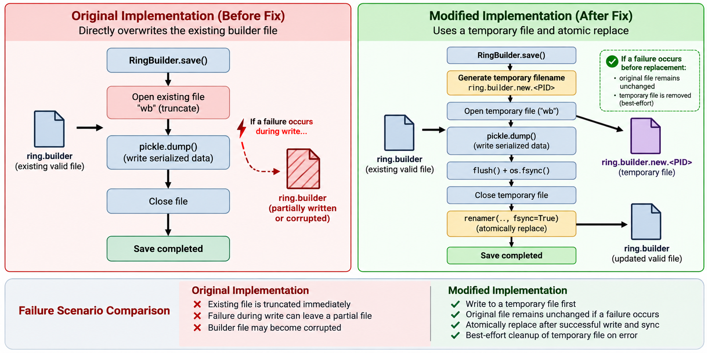
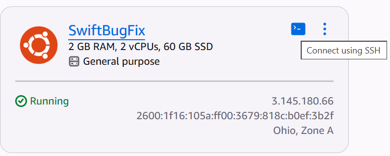

# Design Document

*Due in the `demo-2` branch, updated for `demo-3` and `final-demo`.
**The TA will run this document.** If they cannot follow it, you lose the points.*

## 1. Architecture

Our project addresses a reliability issue in OpenStack Swift's RingBuilder save operation. Previously, `RingBuilder.save()` wrote serialized data directly to the existing builder file. If an error occurred during serialization, the file could be left partially written or corrupted. We modified the `save()` method in `swift/common/ring/builder.py` to use a temporary-file-based
atomic-save mechanism.

### Implemented Save Process

The updated implementation performs the following steps:

0. **Absolute destination:** `builder_file` is converted to an absolute path with `os.path.abspath()`, so the temporary file's directory and the rename destination are always real directories, including when `swift-ring-builder` is run from the ring directory with a bare name such as `object.builder`.

1. **Temporary file creation:** `NamedTemporaryFile(mode='wb', dir=<destination directory>, prefix=<destination name>, delete=False)` creates a uniquely named temporary file beside the destination builder file. The name starts with the destination's filename and ends with a random suffix chosen by Python's `tempfile` module.

2. **Serialization:** The builder state is serialized into the temporary file using `pickle.dump()`.

3. **File synchronization:** The implementation calls `flush()` and `os.fsync()` before closing the temporary file.

4. **Atomic replacement:** Swift's `renamer()` helper replaces the destination builder file with the completed temporary file, using `fsync=True`.

5. **Failure handling:** Steps 1–4 run inside one `try` block, so an exception at any of them, including a failed rename, is handled the same way: the implementation attempts to remove the temporary file, resets a builder ID that was newly assigned during the failed save to `None`, and re-raises the original exception.

### Architecture Diagram


### Composite Ring Builder

The same issue existed in `CompositeRingBuilder.save()` in
`swift/common/ring/composite_builder.py`, which persists the composite ring
metadata: the list of component builder files and their IDs, versions, and
replica counts. Upstream opened the destination with `open(path_to_file, 'wt')`,
which truncates it immediately, then built the metadata and streamed
`json.dump()` into the live file with no `fsync`. An error or crash part-way
through left an empty or truncated JSON file, and the next
`CompositeRingBuilder.load()` failed with *"File does not contain valid composite
ring data"*. A reader running during a save could see the same partial state.

Compared with upstream Swift, the module changes in two places: it imports
`NamedTemporaryFile` from `tempfile` and `renamer` from `swift.common.utils`,
and `save()` is rewritten. Nothing else in the composite builder changes.

### Implemented Composite Save Process

The updated `CompositeRingBuilder.save()` performs the following steps:

1. **Guard:** the existing "No composed ring to save" check runs before any file is touched.

2. **Absolute destination:** `path_to_file` is converted to an absolute path, so the temporary file's directory and the rename destination are always real directories, including for a bare file name such as `composite.json`.

3. **Metadata preparation:** `to_dict()`, `saved_path`, and `serialization_version` are built before any file is opened. The persisted format is unchanged.

4. **Temporary file creation:** `NamedTemporaryFile(mode='wt', dir=<destination directory>, prefix=<destination name>, delete=False)` creates a uniquely named file beside the destination.

5. **Serialization and synchronization:** the metadata is written with `json.dump()`, then `flush()` and `os.fsync()` are called before the temporary file is closed.

6. **Atomic replacement:** `renamer()` replaces the destination with the completed temporary file, using `fsync=True` to sync the containing directory.

7. **Failure handling:** if an exception occurs, the temporary file is removed (ignoring an `OSError` from the removal itself) and the original exception is re-raised.

## 2. Design decisions

### Temporary File Instead of Direct Overwrite

The main design decision was to avoid writing directly to the existing builder file. In the original implementation, opening the destination with `"wb"` could truncate the file before serialization completed. A failure during `pickle.dump()` could therefore leave the builder file corrupted. The modified implementation writes to a temporary file first. This allows serialization to finish before the existing file is replaced.

### File Synchronization Before Replacement

We use `flush()` and `os.fsync()` before replacing the destination. `flush()` transfers buffered data from Python to the operating system, while `os.fsync()` requests synchronization of the file data to storage. This ordering reduces the risk of replacing a valid builder with a temporary file whose contents have not been fully synchronized.

### Using Swift's renamer() Helper

Instead of manually deleting the original file and then moving the temporary file, the implementation uses Swift's existing
`renamer()` helper with `fsync=True`. This avoids an intermediate step in which the destination is explicitly removed before the replacement is ready. Atomic replacement depends on the filesystem and rename semantics. The experiments are intended to verify the relevant behavior in the Linux test environment.

### Temporary Filename Selection

The implementation uses Python's `tempfile.NamedTemporaryFile` to create the temporary file, rather than building a name from the process ID. `NamedTemporaryFile` creates the file atomically with a random suffix, so each save operation gets its own temporary file, including saves from different threads of the same process, which share a process ID. The file is created in the destination's directory, so the final rename stays on one filesystem, and its name starts with the destination's filename, so a leftover temporary file is easy to attribute. `delete=False` keeps the file after it is closed so `renamer()` can install it.

Unique temporary names prevent two saves from writing into the same temporary file. They do not decide which of two concurrent saves to the same destination is installed last; that ordering remains outside the scope of the experiments.

### Error Handling and Cleanup

The implementation attempts to delete the temporary file when an exception occurs. It also restores a newly assigned builder ID to `None` if the save fails, preventing an unsuccessful save from leaving a newly generated ID assigned in memory. The cleanup mechanism is best-effort. For example, a process terminated without executing exception handlers may leave a temporary file behind.

### Composite Builder: Same Protocol as RingBuilder

`CompositeRingBuilder.save()` follows the same temporary-file, `fsync`, and
`renamer()` protocol as `RingBuilder.save()`, for the same reasons given above.
Using one protocol for both files means a builder file and its composite
metadata behave the same way when a save is interrupted, and reviewers see the
existing Swift helper rather than a new mechanism.

### Both Builders: Absolute Destination Path

Swift's `renamer()` creates the destination's directory before renaming, and
`os.path.dirname()` of a bare file name is the empty string, for which that
step fails. Upstream's `open()` handled bare names: `swift-ring-builder` is
commonly run from the ring directory with a bare builder name, and upstream's
own `test_abs_paths_persisted` saves a composite with a relative name.
Converting the destination to an absolute path once, at the start of
`save()`, keeps that behavior and gives the temporary file and the rename the
same location. `RingBuilder.save()` does this for `builder_file`, and
`CompositeRingBuilder.save()` does it for `path_to_file`, which also becomes
the recorded `saved_path`.

### Composite Builder: Metadata Before the File

The metadata is built before the temporary file is opened. Upstream built it
inside the `with open(...)` block, after the live file had already been
truncated. Building it first separates preparing the data from writing it, and
an error in `to_dict()` creates no file at all.

### Composite Builder: Unique Temporary Names

Like `RingBuilder.save()`, the composite save uses `NamedTemporaryFile`, so
each save gets a unique temporary file in the destination's directory, named
with the destination as a prefix. `delete=False` keeps the file after it is
closed so `renamer()` can install it.

### Composite Builder: File Permissions

`NamedTemporaryFile` creates files with mode `0600`, and the rename installs
that mode, so a saved composite file is readable only by its owner even if the
previous file was, for example, `0644`. We accept this narrowing: the composite
metadata is read by `swift-ring-composer`, normally as the same user. A save
never makes the file more permissive, which experiment 11 checks.

### Remaining Limitations

The patches improve failure safety for individual RingBuilder saves and for
composite-builder metadata saves, but they do not establish complete
concurrent-save isolation between multiple writers. Experiments 2–4 focus on
process interruption, exception handling, and durability ordering for individual
RingBuilder saves; experiments 5–11 do the same for composite-builder saves and
add path, repetition, concurrent-reader, and permission checks. Multiple
concurrent writers and power loss remain outside the scope of these experiments.

## 3. Setup

### Setup on a new machine

The whole environment is built by one script. On a clean Ubuntu 24.04 machine:

```bash
git clone https://github.com/HankWang05/EC528_swift
cd EC528_swift
git switch demo3bugs
bash experiments/setup.sh
```

The experiment scripts and `setup.sh` are on the `demo3bugs` branch of
`EC528_swift`, in its `experiments/` directory. The copies in this course
repository's `experiments/bug_fix/` are identical and are included for
submission.

What the script does

| Step | What happens |
| --- | --- |
| Host checks | Requires Linux (exit `77` otherwise), reports the distro, finds `sudo`, checks `python3` and free disk. |
| System packages | Installs the 16 `[platform:dpkg]` packages from Swift's `bindep.txt`: `build-essential`, `gcc`, `liberasurecode-dev`, `libffi-dev`, `libxml2-dev`, `libxslt1-dev`, `libssl-dev`, `memcached`, `python3-dev`, `python3-venv`, `rsync`, `xfsprogs`, `attr`, `curl`, `git`, `man-db`. |
| XFS scratch filesystem | Creates a 4 GB XFS loopback image at `/opt/xfs-tmp.img`, mounts it on `/tmp`, and **verifies** an 8 KB xattr can actually be written there. |
| Virtualenv | Creates `./.venv`, or reuses it if it already exists. |
| Python dependencies | Upgrades pip/setuptools/wheel; installs `pbr` on its own first (it is an import-time dependency of `swift/__init__.py`); then `requirements.txt` and `test-requirements.txt`; then `pip install -e . --no-deps` so `import swift` resolves to this checkout. |
| Verify | Checks that `test/unit`, `test/unit/common/ring/test_builder.py` and both experiment scripts exist; imports `swift`, `pbr`, `eventlet`, `xattr`, `pyeclib`, `pytest`, `swiftclient`; and fails if an installed `swift` is shadowing the checkout. |
| Next steps | Prints the revision, the exit code each experiment is expected to produce, and how to activate the venv. |

The versions this is pinned to: **Ubuntu 24.04**, **Python 3.12**, XFS for
`/tmp`.

Exit codes:

| Code | Meaning |
| --- | --- |
| `0` | Environment is ready (or, with `--check`, verified good). |
| `1` | Something failed during provisioning |
| `77` | Refused to run: wrong OS, no root/sudo, or a hard prerequisite missing. |

### Using the team's LightSail instance

The team has a LightSail instance with Ubuntu 24.04 with setup completed.
It is possible to access the instance `SwiftBugFix` after accepting the email invitation to the team's
AWS project. This can be done by clicking `Connect using SSH` in the LightSail dashboard.



## 4. Running the experiments

### Background information

Our swift repo has three branches: `master`, `bugfix`, and `demo3bugs`. `master` has the unmodified version of swift, `bugfix`
has our RingBuilder fix, and `demo3bugs` adds the composite-builder fix on top of the RingBuilder fix.

The experiment scripts (experiments 0–11) are on `demo3bugs` only; `master` and
`bugfix` contain the Swift code but no `experiments/` directory. Run every
experiment from a `demo3bugs` checkout and choose the implementation under test
with `--swift-src`. Every experiment passes on `demo3bugs`.

Checking out `demo3bugs`

```bash
git checkout demo3bugs
```

To compare with the other branches, add them as separate worktrees next to the
`demo3bugs` checkout. This does not switch the current checkout:

```bash
git worktree add ../EC528_swift-master master
git worktree add ../EC528_swift-bugfix bugfix
```

Then run the same script against each tree, for example:

```bash
python3 experiments/exp2_interrupted_save.py --swift-src ../EC528_swift-master
python3 experiments/exp2_interrupted_save.py --swift-src ../EC528_swift-bugfix
python3 experiments/exp2_interrupted_save.py --swift-src "$PWD"
```

We recommend running experiments 2–4 against all three trees to best visualize
the comparison. Against `master`, experiments 2–4 are expected to **fail**;
against `bugfix` and `demo3bugs`, they are expected to **pass**. Experiment 1
runs `TestRingBuilder.test_save_partial_dump_does_nothing`, which was added with
the fix and is not on `master`, so against `master` it reports exit `77`
(`SKIP (test not found)`) rather than a failure; it passes on `bugfix` and
`demo3bugs`.

The composite experiments compare the same way, against `master` and
`demo3bugs` (`bugfix` does not contain the composite fix). Against `master`,
experiments 6–10 are expected to **fail**; experiments 5 and 11 pass on both,
because they check behavior the fix must keep.

```bash
python3 experiments/exp6_composite_partial_dump.py --swift-src ../EC528_swift-master
python3 experiments/exp6_composite_partial_dump.py --swift-src "$PWD"
```

The worktrees can be removed afterwards with `git worktree remove ../EC528_swift-master`
and `git worktree remove ../EC528_swift-bugfix`.

### Experiment 0: Running all unit tests

| | |
| --- | --- |
| Supports | Records Swift unit-suite results before and after the fix to detect regressions; passing unit tests does not establish full system correctness. |
| Command | `python3 experiments/exp0_unittests.py --swift-src "$PWD"` |
| Expected runtime | Up to 30 minutes (the script's own hard timeout). |
| Expected output | A banner per phase — `environment`, `swift checkout`, `dependencies`, then pytest's own summary — ending in a `result` block with `elapsed`, `collected`, `failed`, `errors`, `skipped`, and the first failing tests if any. |

```bash
cd /path/to/EC528_swift
source .venv/bin/activate

python3 experiments/exp0_unittests.py \
    --swift-src "$PWD" \
    --results-json baseline.json \
    --timeout 1800
echo "exit=$?"
```

#### In the team's LightSail instance

```bash
cd /home/ubuntu/EC528_swift
source .venv/bin/activate

python3 experiments/exp0_unittests.py \
    --swift-src "$PWD" \
    --results-json baseline.json \
    --timeout 1800
echo "exit=$?"
```

We compare named failures across revisions and inspect pytest output because the runner’s summary can misclassify some failures.

### Experiment 1: preservation after partial serialization

| | |
| --- | --- |
| Supports | An injected partial-pickle failure preserves the previous individual-builder file and leaves it loadable. This does not kill a process or exercise composite metadata or ring-position lookups. |
| Command | `python3 experiments/exp1_run_partial_dump_test.py --swift-src "$PWD"` |
| Expected runtime | Normally seconds; the existing runner selects exactly `TestRingBuilder.test_save_partial_dump_does_nothing`. |
| Expected output | After the fix (`bugfix`, `demo3bugs`): the test passes with exit `0`. Against `master`, the test does not exist, so the runner reports `SKIP (test not found)` with exit `77`. |

```bash
cd /path/to/EC528_swift
source .venv/bin/activate
python3 experiments/exp1_run_partial_dump_test.py --swift-src "$PWD"

echo "exit=$?"
```

#### In the team's LightSail instance

```bash
cd /home/ubuntu/EC528_swift
source .venv/bin/activate
python3 experiments/exp1_run_partial_dump_test.py --swift-src "$PWD"

echo "exit=$?"
```

### Experiment 2: process interruption leaves a complete old or new builder

| | |
| --- | --- |
| Supports | Killing the writer before replacement preserves the previous builder; killing it just after replacement leaves the complete new builder loadable. |
| Command | `python3 experiments/exp2_interrupted_save.py --swift-src "$PWD"` |
| Expected runtime | Normally seconds; the complete worker has a 90-second default deadline. |
| Expected output | Three named tests, followed by `Ran 3 tests`, `OK`, and `RESULT: PASS` when the checks pass. These are the expected successful results for the patched implementation. |

The experiment builds and saves a real, populated `RingBuilder`, records the
original bytes and loaded state, then attempts a changed version in a child
process. It pauses the writer at three controlled points: halfway through
serialization, immediately before rename, and immediately after rename. The
parent kills the paused child with `SIGKILL` and verifies the expected old or
new state and individual partition-device lookups. Before replacement, it also
checks that a later save succeeds despite any stale temporary file.

The post-rename check is about **process death with the OS still running**; it
does not establish survival of power loss before the directory sync.

#### How to run the experiment

```bash
cd /path/to/EC528_swift
source .venv/bin/activate
python3 experiments/exp2_interrupted_save.py --swift-src "$PWD"

echo "exit=$?"
```

#### In the team's LightSail instance

```bash
cd /home/ubuntu/EC528_swift
source .venv/bin/activate
python3 experiments/exp2_interrupted_save.py \
    --swift-src "$PWD" \
    --results-json exp2-interrupted-save.json \
    --timeout 90
echo "exit=$?"
```

A passing patched run ends with `exit=0`. On the original implementation,
the halfway serialization can corrupt the live file, and no rename occurs at
the other rendezvous points; those are failed checks, not successful atomicity
evidence. A hard kill may leave a temporary file; this experiment does not
require impossible exception cleanup after `SIGKILL`.

### Experiment 3: handled failures preserve the old builder and clean up

| | |
| --- | --- |
| Supports | Before replacement, handled serialization, explicit-flush, file-sync, and replacement failures preserve the old builder, propagate the injected error, and remove the attempt's temporary file. A failed first save restores an unpersisted ID. |
| Command | `python3 experiments/exp3_save_failure_cleanup.py --swift-src "$PWD"` |
| Expected runtime | Normally seconds; 90-second default worker deadline. |
| Expected output | Five named tests, followed by `Ran 5 tests`, `OK`, and `RESULT: PASS` when the checks pass. These are the expected successful results for the patched implementation. |

Each failure is injected into the real save method while attempting a changed
builder version. The checks require the exact injected exception, byte-identical
old contents, successful reload and partition-device lookups, and no additional
files left after the attempt. The fifth check fails an initial save and verifies
that neither a destination nor a temporary file remains and the new ID is reset.

This covers errors handled by the `except Exception` path. It does not require
rollback after rename has already committed a replacement or cleanup following
an uncatchable process kill.

#### How to run the experiment

```bash
cd /path/to/EC528_swift
source .venv/bin/activate
python3 experiments/exp3_save_failure_cleanup.py --swift-src "$PWD"

echo "exit=$?"
```

#### In the team's LightSail instance

```bash
cd /home/ubuntu/EC528_swift
source .venv/bin/activate
python3 experiments/exp3_save_failure_cleanup.py \
    --swift-src "$PWD" \
    --results-json exp3-save-failure-cleanup.json \
    --timeout 90
echo "exit=$?"
```

A passing patched run ends with `exit=0`. On the original implementation,
a partial serialization damages the live file and some explicit failure points
are not executed. Failures therefore need interpretation by test name; the
runner does not automatically label every failure as file corruption.

### Experiment 4: successful saves follow the durability operation order

| | |
| --- | --- |
| Supports | A changed builder is serialized to a same-directory temporary file, explicitly flushed, file-synced, closed, renamed into place, and followed by a sync of its containing directory. The installed state is complete and loadable. |
| Command | `python3 experiments/exp4_save_durability_order.py --swift-src "$PWD"` |
| Expected runtime | Normally seconds; 90-second default worker deadline. |
| Expected output | One named test, the observed operation sequence, `Ran 1 test`, `OK`, and `RESULT: PASS` when the checks pass. These are the expected successful results for the patched implementation. |

The experiment observes **real** serialization, flush, file-descriptor sync,
close, and rename calls. It checks that the live file remains unchanged until
replacement, that the candidate is complete and closed before rename, and that
the synced directory descriptor identifies the destination's actual parent.
After saving, the new version must reload with the intended state and valid
partition-device lookups, and the temporary filename must no longer exist.

Expected sequence:

```text
serialize -> flush -> file_fsync -> close -> rename -> directory_fsync
```

#### How to run the experiment

```bash
cd /path/to/EC528_swift
source .venv/bin/activate
python3 experiments/exp4_save_durability_order.py --swift-src "$PWD"

echo "exit=$?"
```

#### In the team's LightSail instance

```bash
cd /home/ubuntu/EC528_swift
source .venv/bin/activate
python3 experiments/exp4_save_durability_order.py \
    --swift-src "$PWD" \
    --results-json exp4-save-durability-order.json \
    --timeout 90
echo "exit=$?"
```

A passing run ends with `exit=0`. The original direct-overwrite implementation
should fail because it opens the live file rather than a temporary file and
does not perform the required sequence. A missing or failed directory sync is
not accepted as proof of the complete protocol.

### Experiment 5: composite unit tests still pass

| | |
| --- | --- |
| Supports | Upstream's composite builder tests still pass after the change: compose, save, load, the persisted metadata format, relative-path saving, save errors, and the cooperative builder. Regression evidence only; no upstream test interrupts a save. |
| Command | `python3 experiments/exp5_composite_unittests.py --swift-src "$PWD"` |
| Expected runtime | Normally seconds; 600-second default timeout. |
| Expected output | A banner per phase — `environment`, `swift checkout`, `dependencies`, then pytest's own summary — ending in `58 passed` (upstream's 43 tests plus the 15 composite atomic-save unit tests described below), a `result` block, and `RESULT: PASS`. |

The runner executes `test/unit/common/ring/test_composite_builder.py` and nothing
else. An import or collection error in `composite_builder.py` is reported as
exit `77`, not as a result.

#### How to run the experiment

```bash
cd /path/to/EC528_swift
source .venv/bin/activate
python3 experiments/exp5_composite_unittests.py --swift-src "$PWD"

echo "exit=$?"
```

#### In the team's LightSail instance

```bash
cd /home/ubuntu/EC528_swift
source .venv/bin/activate
python3 experiments/exp5_composite_unittests.py \
    --swift-src "$PWD" \
    --results-json exp5-composite-unittests.json \
    --timeout 600
echo "exit=$?"
```

A passing run ends with `exit=0`. It also passes on the original implementation;
experiments 6–10 show the difference.

### Experiment 6: composite preservation after partial serialization

| | |
| --- | --- |
| Supports | An injected partial `json.dump` failure preserves the previous composite file byte-for-byte, leaves it loadable, and still composes the same ring. This does not kill a process. |
| Command | `python3 experiments/exp6_composite_partial_dump.py --swift-src "$PWD"` |
| Expected runtime | Normally seconds; 90-second default worker deadline. |
| Expected output | The file size and load status before and after, `identical True`, `Ran 1 test`, `OK`, and `RESULT: PASS`. These are the expected successful results for the patched implementation. |

The experiment composes a real composite from two component builders in
different regions and saves it. It then patches `json.dump` to write half of the
metadata and raise `OSError`, and checks the original bytes, the reloaded
metadata, the composed partition-to-device assignment, and that no temporary
file remains.

#### How to run the experiment

```bash
cd /path/to/EC528_swift
source .venv/bin/activate
python3 experiments/exp6_composite_partial_dump.py --swift-src "$PWD"

echo "exit=$?"
```

#### In the team's LightSail instance

```bash
cd /home/ubuntu/EC528_swift
source .venv/bin/activate
python3 experiments/exp6_composite_partial_dump.py \
    --swift-src "$PWD" \
    --results-json exp6-composite-partial-dump.json \
    --timeout 90
echo "exit=$?"
```

A passing patched run ends with `exit=0`. On the original implementation the
truncated file fails to load with *"File does not contain valid composite ring
data"*.

### Experiment 7: composite process interruption leaves a complete old or new file

| | |
| --- | --- |
| Supports | Killing the writer before replacement preserves the previous composite file; killing it just after replacement leaves the complete new file loadable. |
| Command | `python3 experiments/exp7_composite_interrupted_save.py --swift-src "$PWD"` |
| Expected runtime | Normally seconds; the complete worker has a 90-second default deadline. |
| Expected output | Four named tests, followed by `Ran 4 tests`, `OK`, and `RESULT: PASS` when the checks pass. These are the expected successful results for the patched implementation. |

The experiment saves a real composite, records the original bytes, loaded state,
and composed assignment, then attempts a changed version in a child process. It
pauses the writer at four controlled points: halfway through serialization,
after serialization but before the temporary file's `fsync`, immediately before
rename, and immediately after rename. The parent kills the paused child with
`SIGKILL` and verifies the expected old or new state and the composed
partition-to-device assignment. Before replacement, it also checks that a later
save succeeds despite any stale temporary file.

The post-rename check is about **process death with the OS still running**; it
does not establish survival of power loss before the directory sync.

#### How to run the experiment

```bash
cd /path/to/EC528_swift
source .venv/bin/activate
python3 experiments/exp7_composite_interrupted_save.py --swift-src "$PWD"

echo "exit=$?"
```

#### In the team's LightSail instance

```bash
cd /home/ubuntu/EC528_swift
source .venv/bin/activate
python3 experiments/exp7_composite_interrupted_save.py \
    --swift-src "$PWD" \
    --results-json exp7-composite-interrupted-save.json \
    --timeout 90
echo "exit=$?"
```

A passing patched run ends with `exit=0`. On the original implementation the
halfway serialization corrupts the live file, and no `fsync` or rename occurs at
the other points; those are failed checks.

### Experiment 8: composite handled failures preserve the old file and clean up

| | |
| --- | --- |
| Supports | Before replacement, handled serialization, explicit-flush, file-sync, and replacement failures preserve the old composite file, propagate the injected error, and remove the attempt's temporary file. A failed first save creates no file, a failing cleanup does not mask the original error, an uncomposed save is rejected without touching the file, and a retry succeeds. |
| Command | `python3 experiments/exp8_composite_save_failure_cleanup.py --swift-src "$PWD"` |
| Expected runtime | Normally seconds; 90-second default worker deadline. |
| Expected output | Eight named tests, followed by `Ran 8 tests`, `OK`, and `RESULT: PASS` when the checks pass. These are the expected successful results for the patched implementation. |

Each failure is injected into the real save method while attempting a changed
composite version. The checks require the exact injected exception,
byte-identical old contents, successful reload and composition, and no
additional files left after the attempt.

This covers errors handled by the `except Exception` path. It does not require
rollback after rename has already committed a replacement or cleanup following
an uncatchable process kill.

#### How to run the experiment

```bash
cd /path/to/EC528_swift
source .venv/bin/activate
python3 experiments/exp8_composite_save_failure_cleanup.py --swift-src "$PWD"

echo "exit=$?"
```

#### In the team's LightSail instance

```bash
cd /home/ubuntu/EC528_swift
source .venv/bin/activate
python3 experiments/exp8_composite_save_failure_cleanup.py \
    --swift-src "$PWD" \
    --results-json exp8-composite-save-failure-cleanup.json \
    --timeout 90
echo "exit=$?"
```

A passing patched run ends with `exit=0`. On the original implementation a
partial serialization damages the live file and the flush, file-sync, and rename
failure points are never reached, so those checks fail by name.

### Experiment 9: composite successful saves follow the durability operation order

| | |
| --- | --- |
| Supports | Changed composite metadata is serialized to a same-directory temporary file, explicitly flushed, file-synced, closed, renamed into place, and followed by a sync of its containing directory. The live file is never opened for writing, and the installed state is complete and loadable. |
| Command | `python3 experiments/exp9_composite_save_durability_order.py --swift-src "$PWD"` |
| Expected runtime | Normally seconds; 90-second default worker deadline. |
| Expected output | One named test, the observed operation sequence, `Ran 1 test`, `OK`, and `RESULT: PASS` when the checks pass. These are the expected successful results for the patched implementation. |

The experiment observes **real** serialization, flush, file-descriptor sync,
close, and rename calls. It checks that the live file is never opened for
writing and remains unchanged until replacement, that the candidate holds the
complete metadata when synced and is closed before rename, and that the synced
directory descriptor identifies the destination's actual parent. After saving,
the new version must reload with the intended state, compose the same ring, and
leave no temporary filename.

Expected sequence:

```text
serialize -> flush -> file_fsync -> close -> rename -> directory_fsync
```

#### How to run the experiment

```bash
cd /path/to/EC528_swift
source .venv/bin/activate
python3 experiments/exp9_composite_save_durability_order.py --swift-src "$PWD"

echo "exit=$?"
```

#### In the team's LightSail instance

```bash
cd /home/ubuntu/EC528_swift
source .venv/bin/activate
python3 experiments/exp9_composite_save_durability_order.py \
    --swift-src "$PWD" \
    --results-json exp9-composite-save-durability-order.json \
    --timeout 90
echo "exit=$?"
```

A passing run ends with `exit=0`. The original direct-overwrite implementation
fails with "save opened the live composite file for writing".

### Experiment 10: composite paths, repetition, and concurrent readers

| | |
| --- | --- |
| Supports | A save given a bare file name works in the current directory and records an absolute `saved_path`; a save to a new directory leaves the original untouched; repeated saves leave no temporary files; the persisted format is unchanged; and a concurrent reader never sees a partial file. |
| Command | `python3 experiments/exp10_composite_save_edge_cases.py --swift-src "$PWD"` |
| Expected runtime | Normally seconds; 90-second default worker deadline. |
| Expected output | Five named tests, the reader's load count across 200 saves, `Ran 5 tests`, `OK`, and `RESULT: PASS` when the checks pass. These are the expected successful results for the patched implementation. |

The concurrent-reader test starts a separate process that loads the composite
continuously while the parent performs 200 saves; every load must succeed and
report a version that was actually saved. The other tests observe where the
temporary file is created and compare the saved JSON with upstream's keys and
values.

#### How to run the experiment

```bash
cd /path/to/EC528_swift
source .venv/bin/activate
python3 experiments/exp10_composite_save_edge_cases.py --swift-src "$PWD"

echo "exit=$?"
```

#### In the team's LightSail instance

```bash
cd /home/ubuntu/EC528_swift
source .venv/bin/activate
python3 experiments/exp10_composite_save_edge_cases.py \
    --swift-src "$PWD" \
    --results-json exp10-composite-save-edge-cases.json \
    --timeout 90
echo "exit=$?"
```

A passing run ends with `exit=0`. One writer is used; multiple concurrent
writers are not tested.

### Experiment 11: composite saves never make the file more permissive

| | |
| --- | --- |
| Supports | An update may keep or remove the composite file's permissions but never adds any, and a first save does not exceed an ordinary file's mode under the current umask. |
| Command | `python3 experiments/exp11_composite_save_file_mode.py --swift-src "$PWD"` |
| Expected runtime | Normally seconds; 90-second default worker deadline. |
| Expected output | The mode after each update and after a first save, `Ran 2 tests`, `OK`, and `RESULT: PASS` when the checks pass. |

The update test starts from each of `0600`, `0640`, `0644`, `0660`, and `0664`.
The first-save test compares the saved file with one created by a plain `open()`
in the same directory. The patched save produces `0600`, the narrowing described
in [Composite Builder: File Permissions](#composite-builder-file-permissions).

#### How to run the experiment

```bash
cd /path/to/EC528_swift
source .venv/bin/activate
python3 experiments/exp11_composite_save_file_mode.py --swift-src "$PWD"

echo "exit=$?"
```

#### In the team's LightSail instance

```bash
cd /home/ubuntu/EC528_swift
source .venv/bin/activate
python3 experiments/exp11_composite_save_file_mode.py \
    --swift-src "$PWD" \
    --results-json exp11-composite-save-file-mode.json \
    --timeout 90
echo "exit=$?"
```

A passing run ends with `exit=0`. Only the final file's permission bits are
checked, not ownership or ACLs.

### Atomic-save unit tests in Swift's test suite

The checks from the experiments are also part of Swift's own unit suite, so they
run with every change in Swift's CI. They live beside the existing save tests:

| File | Class | Tests |
| --- | --- | --- |
| `test/unit/common/ring/test_builder.py` | `TestRingBuilder` | 12 save tests: `test_save`, `test_save_load`, `test_save_partial_dump_does_nothing`, explicit-flush, `fsync`, rename, and failed-first-save failures, a failing cleanup, the durability order, a stale temporary file, a bare relative path, and repeated saves. |
| `test/unit/common/ring/test_composite_builder.py` | `TestCompositeRingBuilder` | 15 new tests: partial serialization, explicit-flush, `fsync`, rename, and failed-first-save failures, a failing cleanup, a retry after failure, the durability order, readers seeing the old or new file across the rename, a stale temporary file, a new path, repeated saves, and two permission checks. |

Each test injects one failure with `mock.patch` around the real
`NamedTemporaryFile`, `os.fsync`, and `os.rename`, then checks the exact error,
byte-identical old contents, successful loading and placement, and that no
temporary file is left. The kill and concurrent-reader experiments are
represented by deterministic checks of the on-disk state at each step: a process
killed at that step would leave the same state.

```bash
cd /home/ubuntu/EC528_swift
source .venv/bin/activate
python3 -m pytest test/unit/common/ring/test_builder.py \
    test/unit/common/ring/test_composite_builder.py -k save -v -p no:cacheprovider
flake8 swift/common/ring/builder.py swift/common/ring/composite_builder.py \
    test/unit/common/ring/test_builder.py test/unit/common/ring/test_composite_builder.py
```

| | |
| --- | --- |
| Expected runtime | A few seconds. |
| Expected output | 28 save tests, each `PASSED`, and no flake8 output. |

The experiments remain the evidence for real process kills, real concurrent
readers, and before/after comparisons against other checkouts.

### Experiment 12 and integrated SAIO atomic-save validation

| | |
| --- | --- |
| Supports | Adds a topology-change atomic-save scenario through experiment 12, then runs the required save-path experiments alongside real local SAIO object traffic. The integrated run checks save-test execution and request overlap separately. |
| Command | `bash experiments/run_saio_atomic_under_load.sh` |
| Expected runtime | Approximately 25 minutes of sustained traffic across five cases, plus dataset seeding, final verification, and cleanup. This is a duration target, not a hard wall-clock limit. |
| Expected output | Per-case experiment verdicts, followed by separate `ATOMIC-SAVE CHECKS`, `BACKGROUND TRAFFIC`, and `CLEANUP` summaries, an exit code, and the report location. `INCOMPLETE` means required execution or overlap evidence was not established; it is not a failed atomic-save assertion and is not a verified pass. |

#### Experiment 12: additional purpose

`exp12_topology_change_atomic_save.py` adds a topology-change scenario to the
save-path validation. Its purpose is to cover saving changed topology state,
rather than relying on object traffic alone as evidence that builder saves
were exercised. It complements the interruption, handled-failure, durability
ordering, and composite-save checks in the other experiments.

The integrated runner invokes experiment 12 once for each workload case,
alongside experiments 2–4 and 6–11. Graders do not need to launch experiment 12
separately for this SAIO procedure. The experiment's name does not imply that
the harness deploys new live rings: the integrated run does not modify live
SAIO rings or establish correctness during live rebalance or object migration.

#### Prerequisites

Run the SAIO experiments on the team's Ubuntu-SAIO Lightsail instance,
using the `demo3fixed` branch. Ubuntu-SAIO contains the prepared local Swift
deployment and mounted SAIO storage used by the integrated runner.
The separate SwiftBugFix instance is not used for this procedure.

Run as the normal `ubuntu` user, not as root and not with `sudo bash`.

Use the `demo3fixed` branch for the integrated SAIO experiment.

The checkout must include `saio_atomic_under_load.py`,
`run_saio_atomic_under_load.sh`, `saio_scale_tests_expanded.py`, experiments
2–4 and 6–12, and their support files in `experiments/`. The expanded workload
script must support `--sustain` and the runner's readiness marker.

The launcher is sufficient to start the integrated test on that prepared
instance. It selects `.venv/bin/python` automatically and prepares only the
private scratch parent when needed; `sudo` may prompt for that directory setup.
It does not install or start SAIO, create the virtual environment, mount or
format storage, or provision a fresh machine. If it refuses a prerequisite,
inspect the message rather than resetting the existing SAIO storage.

The default local authentication is `http://127.0.0.1:8080/auth/v1.0`, user
`test:tester`, and key `testing`. If the prepared instance uses different
credentials, set `ST_AUTH`, `ST_USER`, and `ST_KEY` accordingly. Only the local
SAIO authentication endpoints accepted by the workload are permitted.

#### How to run the integrated experiment

From a prepared checkout:

```bash
cd /path/to/EC528_swift
bash experiments/run_saio_atomic_under_load.sh
echo "exit=$?"
```

#### In the team's Lightsail instance

```bash
cd /home/ubuntu/EC528_swift
git switch demo3fixed
bash experiments/run_saio_atomic_under_load.sh
echo "exit=$?"
```

Manual virtual-environment activation is not required for the shell launcher.
For the available runner options without starting tests:

```bash
bash experiments/run_saio_atomic_under_load.sh --help
```

This is the single SAIO entry point for grading. Do not run a second,
standalone scale-test suite: the runner launches and instruments
`saio_scale_tests_expanded.py` internally as its background workload.

The default run selects all five cases sequentially:

| Case | Configured object slots and sizes | Workers | Required experiment executions |
| --- | --- | --- | --- |
| Smoke | 8 slots, 16 KiB each | 2 | 10 |
| Small | 2,000 slots, 16 KiB each | 8 | 10 |
| Medium | 512 slots, 1 MiB each | 8 | 10 |
| Large | 32 slots, 32 MiB each | 4 | 10 |
| Mixed | 256 slots: 181 at 64 KiB, 50 at 1 MiB, 25 at 8 MiB | 8 | 10 |

Each case seeds its dataset, starts a 300-second sustained workload, runs one
round of the ten save experiments, then completes integrity verification and
cleanup before the next case. There are 50 required experiment executions in
total; this counts experiment processes, not the individual assertions within
each script. Save checks run back-to-back after traffic readiness, not repeatedly
throughout all five minutes.

All cases use the sustained operation policy with their respective populations
and sizes. Occupied slots select GET, overwrite, HEAD, or DELETE; selecting an
empty slot recreates it with PUT. Thus the live object population can fluctuate
within the configured slot limit. Builder-save experiments run separately from
these object requests, with their temporary directories placed on the mounted
SAIO storage filesystem. The live topology remains fixed.

#### Expected result and interpreting INCOMPLETE

Inspect all three verdicts separately:

- `ATOMIC-SAVE CHECKS`: requires successful experiment execution and verified
  request overlap for every required execution.
- `BACKGROUND TRAFFIC`: reports workload completion and object-request errors
  separately; errors are not automatically attributed to the save changes.
- `CLEANUP`: reports whether workload completion/cleanup was verified and
  whether cleanup errors were recorded.

`INCOMPLETE` is not `FAIL`. It means the runner could not establish all the
required evidence. For example, an experiment can exit successfully with
`test_execution: "PASS"`, while no successful request both starts and finishes
inside its short process interval. The strict overlap rule then produces
`status: "INCOMPLETE"` and `overlap_verified: false`, even if traffic was still
running. This does not establish a failed save assertion, but it also must not
be counted as an overlap-verified pass. Timeouts, exit `77`, terminated processes,
or missing executions can also leave evidence incomplete; inspect the recorded
reason rather than assuming every incomplete result is a coverage gap.

| Exit code | Meaning |
| --- | --- |
| `0` | All required atomic-save checks passed with overlap, and traffic/cleanup completed cleanly. |
| `1` | At least one experiment was classified as a failure; inspect its log. |
| `2` | Required evidence is incomplete or a runner error occurred. This is distinct from an atomic-save failure and is not a clean pass. |
| `3` | Atomic-save checks passed, but background traffic or cleanup has warnings/errors. |
| `77` | Preflight refused; the required environment was not available. No pass or assertion failure is established. |

The runner prints the report location under
`experiment-results/atomic-under-load-<timestamp>-<id>/`. Inspect its
`summary.json` for overall and per-case verdicts. Each case directory includes
per-experiment logs/JSON, `traffic.log`, the instrumented workload, traffic
reports and request CSVs, and `object_errors.json`.

To print the report, replace the placeholder with the actual run directory:

```bash
.venv/bin/python -m json.tool \
    experiment-results/atomic-under-load-<timestamp>-<id>/summary.json
```

For an incomplete execution, compare `test_execution`, `exit_code`,
`overlap_verified`, and `successful_requests_fully_during_experiment` in the
summary and inspect that experiment's log. Do not reinterpret incomplete
coverage as either an assertion failure or a verified pass.


## 5. Claims and limitations

Experiment 2 tests process interruption before and after replacement. Experiment 3 tests handled failures, preservation of the previous builder, and temporary-file cleanup. Experiment 4 checks the durability operation order. Experiments 5–11 test the composite-builder fix: experiment 5 runs upstream's composite unit tests, experiments 6–9 repeat the partial-serialization, process-interruption, handled-failure, and durability-order checks for the composite file, experiment 10 covers relative and new paths, repeated saves, the persisted format, and a concurrent reader, and experiment 11 checks file permissions. These experiments do not test multiple concurrent writers, actual power loss, or performance.

Validation status: experiments 0–11 have been run on the team's Ubuntu LightSail
instance from the `demo3bugs` checkout, and all of them pass on `demo3bugs`,
which contains both fixes. Run with `--swift-src` against separate worktrees,
experiments 2–4 pass against `bugfix` and fail against `master`, and experiment 1
passes against `bugfix` and reports `SKIP (test not found)` against `master`.
The 28 atomic-save unit tests pass on `demo3bugs`, and the changed files pass
flake8.

### Objectives

Every bug-fix objective from the [design proposal](design-proposal.md) is complete:

| Objective | Status | Evidence |
| --- | --- | --- |
| Make `RingBuilder.save()` atomic | Done | Section 1; experiments 1–4; `TestRingBuilder` save tests |
| Make `CompositeRingBuilder.save()` atomic | Done | Section 1; experiments 5–11; `TestCompositeRingBuilder` save tests |
| After an interrupted save, the last valid file is unchanged, loads, and supports ring position lookups | Done | Experiments 1, 2, 6, 7 |
| Protect the file at every failure point: serialization, flush, `fsync`, and replacement | Done | Experiments 3, 8; unit tests |
| Handle temporary files from failed saves; a stale temporary file must not block a save | Done | Experiments 2, 3, 7, 8, 10; unit tests |
| Give concurrent saves distinct temporary names | Done | `NamedTemporaryFile` in both saves (section 2) |
| Run Swift's existing suite together with new atomic-save tests | Done | Experiments 0, 5; 28 save tests added to Swift's unit suite |
