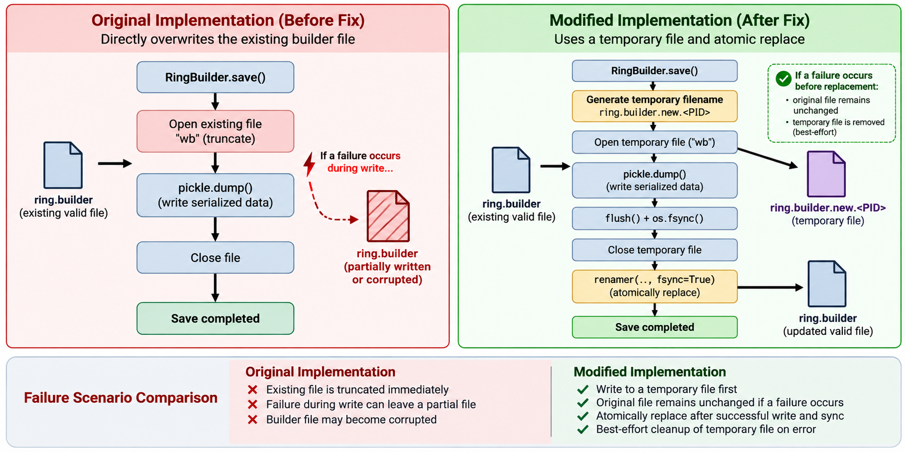
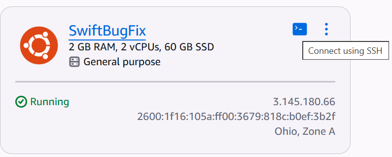

# Design Document

*Due in the `demo-2` branch, updated for `demo-3` and `final-demo`.
**The TA will run this document.** If they cannot follow it, you lose the points.*

## 1. Architecture

Our project addresses a reliability issue in OpenStack Swift's RingBuilder save operation. Previously, `RingBuilder.save()` wrote serialized data directly to the existing builder file. If an error occurred during serialization, the file could be left partially written or corrupted. We modified the `save()` method in `swift/common/ring/builder.py` to use a temporary-file-based
atomic-save mechanism.

### Implemented Save Process

The updated implementation performs the following steps:

1. **Temporary file creation:** A temporary filename is generated by appending `.new.<PID>` to the destination builder filename, where PID is the current process ID.

2. **Serialization:** The builder state is serialized into the temporary file using `pickle.dump()`.

3. **File synchronization:** The implementation calls `flush()` and `os.fsync()` before closing the temporary file.

4. **Atomic replacement:** Swift's `renamer()` helper replaces the destination builder file with the completed temporary file, using `fsync=True`.

5. **Failure handling:** If an exception occurs, the implementation attempts to remove the temporary file. If a new builder ID was assigned during the failed save, it is reset to `None`.

### Architecture Diagram


## 2. Design decisions

### Temporary File Instead of Direct Overwrite

The main design decision was to avoid writing directly to the existing builder file. In the original implementation, opening the destination with `"wb"` could truncate the file before serialization completed. A failure during `pickle.dump()` could therefore leave the builder file corrupted. The modified implementation writes to a temporary file first. This allows serialization to finish before the existing file is replaced.

### File Synchronization Before Replacement

We use `flush()` and `os.fsync()` before replacing the destination. `flush()` transfers buffered data from Python to the operating system, while `os.fsync()` requests synchronization of the file data to storage. This ordering reduces the risk of replacing a valid builder with a temporary file whose contents have not been fully synchronized.

### Using Swift's renamer() Helper

Instead of manually deleting the original file and then moving the temporary file, the implementation uses Swift's existing
`renamer()` helper with `fsync=True`. This avoids an intermediate step in which the destination is explicitly removed before the replacement is ready. Atomic replacement depends on the filesystem and rename semantics. The experiments are intended to verify the relevant behavior in the Linux test environment.

### Temporary Filename Selection

The implementation uses the process ID to construct the temporary filename: `<builder_file>.new.<PID>` This distinguishes temporary files created by different processes in typical cases. However, threads within the same process share the same PID.
As a result, simultaneous saves to the same destination can collide on the temporary filename. Experiment 3 is designed to expose this limitation. A possible future improvement is to generate a unique temporary filename for each save operation.

### Error Handling and Cleanup

The implementation attempts to delete the temporary file when an exception occurs. It also restores a newly assigned builder ID to `None` if the save fails, preventing an unsuccessful save from leaving a newly generated ID assigned in memory. The cleanup mechanism is best-effort. For example, a process terminated without executing exception handlers may leave a temporary file behind.

### Remaining Limitations

The current patch improves failure safety for individual RingBuilder saves, but it does not establish complete
concurrent-save isolation. Additionally, the modification does not automatically make composite-builder metadata saves atomic.Experiments 2–4 focus on process interruption, exception handling, and durability ordering for individual RingBuilder saves. Concurrent saves and composite-builder persistence remain outside the scope of these experiments. Their expected outcomes should not be treated as verified results until the experiments have been executed in the target environment.

## 3. Setup

### Setup on a new machine

The whole environment is built by one script. On a clean Ubuntu 24.04 machine:

```bash
git clone https://github.com/HankWang05/EC528_swift
cd <cloned swift repo directory>
bash experiments/bug_fix/setup.sh
```

What the script does

| Step | What happens |
| --- | --- |
| Host checks | Requires Linux (exit `77` otherwise), reports the distro, finds `sudo`, checks `python3` and free disk. |
| System packages | Installs the 16 `[platform:dpkg]` packages from Swift's `bindep.txt`: `build-essential`, `gcc`, `liberasurecode-dev`, `libffi-dev`, `libxml2-dev`, `libxslt1-dev`, `libssl-dev`, `memcached`, `python3-dev`, `python3-venv`, `rsync`, `xfsprogs`, `attr`, `curl`, `git`, `man-db`. |
| XFS scratch filesystem | Creates a 4 GB XFS loopback image at `/opt/xfs-tmp.img`, mounts it on `/tmp`, and **verifies** an 8 KB xattr can actually be written there. |
| Virtualenv | Creates `./.venv`, or reuses it if it already exists. |
| Python dependencies | Upgrades pip/setuptools/wheel; installs `pbr` on its own first (it is an import-time dependency of `swift/__init__.py`); then `requirements.txt` and `test-requirements.txt`; then `pip install -e . --no-deps` so `import swift` resolves to this checkout. |
| Verify | Checks that `test/unit`, `test/unit/common/ring/test_builder.py` and both experiment scripts exist; imports `swift`, `pbr`, `eventlet`, `xattr`, `pyeclib`, `pytest`, `swiftclient`; and fails if an installed `swift` is shadowing the checkout. |
| Next steps | Prints the revision, the exit code each experiment is expected to produce, and how to activate the venv. |

The versions this is pinned to: **Ubuntu 24.04**, **Python 3.12**, XFS for
`/tmp`.

Exit codes:

| Code | Meaning |
| --- | --- |
| `0` | Environment is ready (or, with `--check`, verified good). |
| `1` | Something failed during provisioning |
| `77` | Refused to run: wrong OS, no root/sudo, or a hard prerequisite missing. |

### Using the team's LightSail instance

The team has a LightSail instance with Ubuntu 24.04 with setup completed.
It is possible to access the instance `SwiftBugFix` after accepting the email invitation to the team's
AWS project. This can be done by clicking `Connect using SSH` in the LightSail dashboard.



## 4. Running the experiments

### Background information

Our swift repo has two branches `master` and `bugfix`. `master` has the unmodified version of swift, and `bugfix`
has our fix. All experiments are runnable on both branches, but under `master`, they are expected to **fail**, and 
under `bugfix`, they are expected to **pass**.  
We recommend running experiments 1-4 once under `master`, then again under `bugfix` to best visualize the comparison.

Checking out `master`

```bash
git checkout master
```

Checking out `bugfix`

```bash
git checkout bugfix
```

### Experiment 0: Running all unit tests

| | |
| --- | --- |
| Supports | Records Swift unit-suite results before and after the fix to detect regressions; passing unit tests does not establish full system correctness. |
| Command | `python3 experiments/exp0_unittests.py --swift-src "$PWD"` |
| Expected runtime | Up to 30 minutes (the script's own hard timeout). |
| Expected output | A banner per phase — `environment`, `swift checkout`, `dependencies`, then pytest's own summary — ending in a `result` block with `elapsed`, `collected`, `failed`, `errors`, `skipped`, and the first failing tests if any. |

```bash
cd /path/to/EC528_swift
source .venv/bin/activate

python3 experiments/exp0_unittests.py \
    --swift-src "$PWD" \
    --results-json baseline.json \
    --timeout 1800
echo "exit=$?"
```

#### In the team's LightSail instance

```bash
cd /home/ubuntu/EC528_swift
source .venv/bin/activate

python3 experiments/exp0_unittests.py \
    --swift-src "$PWD" \
    --results-json baseline.json \
    --timeout 1800
echo "exit=$?"
```

Record actual failures on each revision rather than assuming a fixed failure
count. The existing mocked `test_save` needs updating for the atomic save.
The partial-dump test can also fail its last comparison because loading adds
replication fields absent from its device fixtures. Compare against a freshly
loaded good builder, or populate those fields in the existing test, before
using it as before/after evidence. The experiment 0 runner can also misclassify
an entirely failing suite as aborted collection. Inspect pytest output and named failures, not only the
final runner label.

### Experiment 1: preservation after partial serialization

| | |
| --- | --- |
| Supports | An injected partial-pickle failure preserves the previous individual-builder file and leaves it loadable. This does not kill a process or exercise composite metadata or ring-position lookups. |
| Command | `python3 experiments/exp1_run_partial_dump_test.py --swift-src "$PWD"` |
| Expected runtime | Normally seconds; the existing runner selects exactly `TestRingBuilder.test_save_partial_dump_does_nothing`. |
| Expected output | Before the fix: failure on changed bytes. After the fix: should pass once the fixture comparison described above is corrected. A failure alone does not identify its cause. |

```bash
cd /path/to/EC528_swift
source .venv/bin/activate
python3 experiments/exp1_run_partial_dump_test.py --swift-src "$PWD"

echo "exit=$?"
```

#### In the team's LightSail instance

```bash
cd /home/ubuntu/EC528_swift
source .venv/bin/activate
python3 experiments/exp1_run_partial_dump_test.py --swift-src "$PWD"

echo "exit=$?"
```

### Experiment 2: process interruption leaves a complete old or new builder

| | |
| --- | --- |
| Supports | Killing the writer before replacement preserves the previous builder; killing it just after replacement leaves the complete new builder loadable. |
| Command | `python3 experiments/exp2_interrupted_save.py --swift-src "$PWD"` |
| Expected runtime | Normally seconds; the complete worker has a 90-second default deadline. |
| Expected output | Three named tests, followed by `Ran 3 tests`, `OK`, and `RESULT: PASS` when the checks pass. These are the expected successful results for the patched implementation. |

The experiment builds and saves a real, populated `RingBuilder`, records the
original bytes and loaded state, then attempts a changed version in a child
process. It pauses the writer at three controlled points: halfway through
serialization, immediately before rename, and immediately after rename. The
parent kills the paused child with `SIGKILL` and verifies the expected old or
new state and individual partition-device lookups. Before replacement, it also
checks that a later save succeeds despite any stale temporary file.

The post-rename check is about **process death with the OS still running**; it
does not establish survival of power loss before the directory sync.

#### How to run the experiment

```bash
cd /path/to/EC528_swift
source .venv/bin/activate
python3 experiments/exp2_interrupted_save.py --swift-src "$PWD"

echo "exit=$?"
```

#### In the team's LightSail instance

```bash
cd /home/ubuntu/EC528_swift
source .venv/bin/activate
python3 experiments/exp2_interrupted_save.py \
    --swift-src "$PWD" \
    --results-json exp2-interrupted-save.json \
    --timeout 90
echo "exit=$?"
```

A passing patched run ends with `exit=0`. On the original implementation,
the halfway serialization can corrupt the live file, and no rename occurs at
the other rendezvous points; those are failed checks, not successful atomicity
evidence. A hard kill may leave a temporary file; this experiment does not
require impossible exception cleanup after `SIGKILL`.

### Experiment 3: handled failures preserve the old builder and clean up

| | |
| --- | --- |
| Supports | Before replacement, handled serialization, explicit-flush, file-sync, and replacement failures preserve the old builder, propagate the injected error, and remove the attempt's temporary file. A failed first save restores an unpersisted ID. |
| Command | `python3 experiments/exp3_save_failure_cleanup.py --swift-src "$PWD"` |
| Expected runtime | Normally seconds; 90-second default worker deadline. |
| Expected output | Five named tests, followed by `Ran 5 tests`, `OK`, and `RESULT: PASS` when the checks pass. These are the expected successful results for the patched implementation. |

Each failure is injected into the real save method while attempting a changed
builder version. The checks require the exact injected exception, byte-identical
old contents, successful reload and partition-device lookups, and no additional
files left after the attempt. The fifth check fails an initial save and verifies
that neither a destination nor a temporary file remains and the new ID is reset.

This covers errors handled by the `except Exception` path. It does not require
rollback after rename has already committed a replacement or cleanup following
an uncatchable process kill.

#### How to run the experiment

```bash
cd /path/to/EC528_swift
source .venv/bin/activate
python3 experiments/exp3_save_failure_cleanup.py --swift-src "$PWD"

echo "exit=$?"
```

#### In the team's LightSail instance

```bash
cd /home/ubuntu/EC528_swift
source .venv/bin/activate
python3 experiments/exp3_save_failure_cleanup.py \
    --swift-src "$PWD" \
    --results-json exp3-save-failure-cleanup.json \
    --timeout 90
echo "exit=$?"
```

A passing patched run ends with `exit=0`. On the original implementation,
a partial serialization damages the live file and some explicit failure points
are not executed. Failures therefore need interpretation by test name; the
runner does not automatically label every failure as file corruption.

### Experiment 4: successful saves follow the durability operation order

| | |
| --- | --- |
| Supports | A changed builder is serialized to a same-directory temporary file, explicitly flushed, file-synced, closed, renamed into place, and followed by a sync of its containing directory. The installed state is complete and loadable. |
| Command | `python3 experiments/exp4_save_durability_order.py --swift-src "$PWD"` |
| Expected runtime | Normally seconds; 90-second default worker deadline. |
| Expected output | One named test, the observed operation sequence, `Ran 1 test`, `OK`, and `RESULT: PASS` when the checks pass. These are the expected successful results for the patched implementation. |

The experiment observes **real** serialization, flush, file-descriptor sync,
close, and rename calls. It checks that the live file remains unchanged until
replacement, that the candidate is complete and closed before rename, and that
the synced directory descriptor identifies the destination's actual parent.
After saving, the new version must reload with the intended state and valid
partition-device lookups, and the temporary filename must no longer exist.

Expected sequence:

```text
serialize -> flush -> file_fsync -> close -> rename -> directory_fsync
```

#### How to run the experiment

```bash
cd /path/to/EC528_swift
source .venv/bin/activate
python3 experiments/exp4_save_durability_order.py --swift-src "$PWD"

echo "exit=$?"
```

#### In the team's LightSail instance

```bash
cd /home/ubuntu/EC528_swift
source .venv/bin/activate
python3 experiments/exp4_save_durability_order.py \
    --swift-src "$PWD" \
    --results-json exp4-save-durability-order.json \
    --timeout 90
echo "exit=$?"
```

A passing run ends with `exit=0`. The original direct-overwrite implementation
should fail because it opens the live file rather than a temporary file and
does not perform the required sequence. A missing or failed directory sync is
not accepted as proof of the complete protocol.

## 5. Claims and limitations

Experiments 2–4 specify individual-builder failure safety, concurrent-save
isolation, and composite-metadata failure safety respectively. They do not
measure performance, simulate actual power loss, or demonstrate an end-to-end
composite ring-position lookup. Experiment 2 kills a real child process during
serialization and observes real file/directory sync ordering; that is narrower
than proving power-loss durability. Experiment 3 covers threads in one process,
not independent processes or simultaneous membership changes.

Validation status: the new scripts passed syntax checks and refused to run on
Windows with exit `77`. Their Linux results have not been collected. Expected
outcomes above are based on source inspection, not measured passing results.
