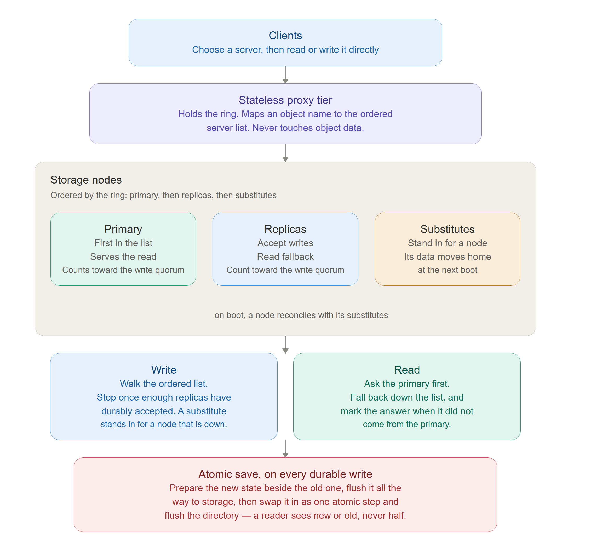
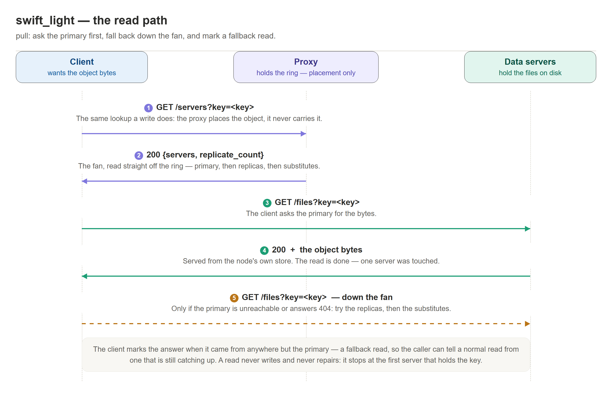
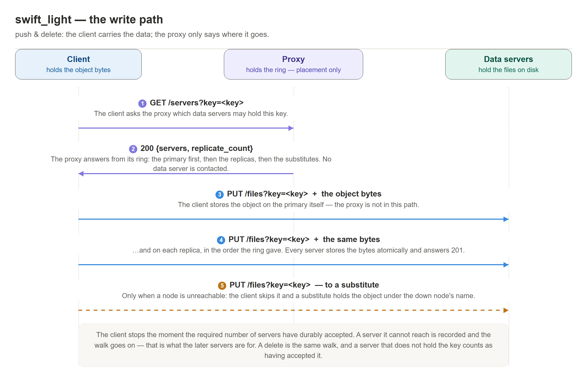

# Design Document

*Due in the `demo-2` branch, updated for `demo-3` and `final-demo`.
**The TA will run this document.** If they cannot follow it, you lose the points.*

## 1. Architecture

`swift_light` is a three-tier object store laid out the way upstream Swift is: a client, a proxy
tier, and a set of storage nodes, with no metadata master anywhere in the path. Placement comes
from a consistent-hashing ring that every proxy holds a copy of, so any proxy can answer "where
does this object live?". The ring is stored on disk, which makes it survives a crash.
For each object the ring yields an ordered list of servers that may
hold it: the primary first, then the remaining replicas, then a set of substitutes further down
the list.  
A client asks the proxy for that list, then talks to the storage nodes directly.



### Read in Swift Light

A read begins with the proxy, which maps the object's key to its fan from the ring. The client
takes that list and reads from the primary (`fan[0]`) first; only if the primary is unreachable or
does not hold the key does it move on, trying the secondaries and then the handoff servers in
turn. Whenever a server other than the primary supplies the object, the client notes the fallback 
so the caller can distinguish a normal read from one that is still catching up.



### Write in Swift Light

A write also starts with the same proxy lookup, but then fans out: the client sends the change to
the whole replica set at once and counts the servers that durably accepted it.
If the replica set comes up short because a replica is down, the handoff servers further down the fan are tried
in order until the quorum is met -- the sloppy quorum -- and a write still succeeds while a
replica is down. If the quorum is never reached, the command fails.



### Adding/Removing a node to/from the cluster
<TODO: Complete>

### Atomic save

Ring metadata, server configuration, and object contents are saved by writing a
temporary file in the destination directory, flushing and synchronizing its contents,
then atomically replacing the destination. Readers see the previous complete file or
the new complete file instead of a partially written replacement. The system also
attempts to synchronize the containing directory. This applies to each local file;
it does not make an update atomic across all replicas.

## 2. Design decisions

### Ring-based placement

We use a consistent-hashing ring to produce an ordered server list from the object's
key. This keeps placement deterministic without maintaining a separate location record
for every object. Compared with Swift's partition and device-management logic, our
ring is simpler so we can focus on placement and replication in a small cluster.

### Direct client-to-server transfers

The proxy returns placement information, and the client transfers object data directly
with storage servers. Unlike routing object data through the proxy as Swift does,
this separates the lookup from the data transfer and makes the request path easier to
follow. The client therefore handles replica attempts and fallback itself.

### Two acknowledged copies

Our default cluster has three storage servers and requires two distinct servers to
acknowledge a write. Requiring only one copy would provide less redundancy, while
requiring all three would prevent writes whenever one server is unavailable. The
client tries substitutes when necessary, but this acknowledgement threshold does not
provide strong consistency or guarantee that a read returns the newest version.

### Temporary files instead of overwriting in place

We use atomic replacement to avoid exposing partially written files. This carries the
same principle as the RingBuilder bug fix into Swift Light's metadata and object
writes. Synchronization adds work to each save; measuring that performance cost is
planned for Demo3. Directory synchronization is best-effort, so we do not claim
unconditional power-loss durability.

## 3. Setup

### Hardware Assumptions

| | |
| --- | --- |
| OS | Linux |
| Python | 3.12 |
| Disk | A few GB.|
| Free ports | `8000` (proxy, for clients), `8010` (proxy, for data servers), and `9001`–`9003` (the three data servers).|

```bash
git clone https://github.com/ec528-fall26/swift.git
cd <cloned swift repo directory>
git checkout Demo2_BugFix
```

### Using the team's LightSail instance

The team has a LightSail instance with Ubuntu 24.04 with setup completed.
It is possible to access the instance `SwiftLight` after accepting the email invitation to the team's
AWS project. This can be done by clicking `Connect using SSH` in the LightSail dashboard.

### Starting the cluster

`deploy.py` is the entry point of the system. For experimenting basic functions, it starts the cluster with
three data servers, and a write is considered success after 2 write success is received.

```bash
cd /home/ubuntu/swift
python3 src/swift_light/deploy.py up
python3 src/swift_light/deploy.py status
```

### Shutting down

```bash
python3 src/swift_light/deploy.py down
```

### Exit codes

| Code | Meaning |
| --- | --- |
| `0` | The command succeeded. |
| `1` | The command ran but the cluster misbehaved: a process died, the ring does not describe the cluster asked for, nothing answered in time, or a write reached fewer than `replicate_count` replicas. |
| `77` | The command could not be attempted: bad arguments, a port already in use, or a ring that cannot be built. |

## 4. Running the experiments

Experiments 1 and 2 need the cluster running. Experiment 0 deploys and stops its own
cluster in the mode it measures, and experiments 3, 4 and 5 run the test suites on
temporary state. Once the setup process is completed, all of them can be run in a
separate terminal.

Experiments 1 and 2 also expect the team's files `SwiftLightFiles/Hello.txt`.

### Experiment 0: what atomic mode costs in operation

| | |
| --- | --- |
| Supports | Atomic mode writes more per case than non-atomic mode, and the difference is small that the performance sacrafise is affordable. |
| Command | `python3 experiments/swift_light/exp0_atomic_overhead.py --mode <MODE?>` |
| Expected runtime | Roughly 20 minutes |
| Expected output | A per-case table (cases, failures, seconds, ms/case, p50/p95/p99, cases/second), the ring writes and the cost of one, and `every case succeeded`. |
| Requires | The cluster deployed in the mode `--mode` names; the experiment is run once per mode. |

**Note: This experiment requires the system to be deployed in specific momdes, so please do not follow the setup instruction
for this experiment only. Detailed setup instructions are included in the bash command below.**

#### How to run the experiment

```bash
cd <cloned swift repo directory>

python src/swift_light/deploy.py up non_atomic
python experiments/swift_light/exp0_atomic_overhead.py --mode non_atomic --json non_atomic.json
echo "exit=$?"
python src/swift_light/deploy.py down

python src/swift_light/deploy.py up
python experiments/swift_light/exp0_atomic_overhead.py --mode atomic --json atomic.json
echo "exit=$?"
python src/swift_light/deploy.py down
```

#### In the team's LightSail instance

```bash
cd /home/ubuntu/swift

python3 src/swift_light/deploy.py up non_atomic
python3 experiments/swift_light/exp0_atomic_overhead.py --mode non_atomic --json non_atomic.json
echo "exit=$?"
python3 src/swift_light/deploy.py down

python3 src/swift_light/deploy.py up
python3 experiments/swift_light/exp0_atomic_overhead.py --mode atomic --json atomic.json
echo "exit=$?"
python3 src/swift_light/deploy.py down
```

Runs 10,000 cases against the running cluster: 80% on data (half writing a file,
half deleting one written earlier) and 20% on the ring (half adding a data
server, half removing one).  

For data writes, one case corresponds to one write/remove, but for the ring, 100 cases results in 3 write/remove.
This is because adding/remomving one machine to the cluster requires 100 ring changes(one per vnode). If the system
persists to disk after every vnode change, the performance will be unacceptable. The system, instead, stash changes and
flush 50 vnodes at once. See the *Architecture* section for details.

This experiment starts and stops its own cluster.

Each case is a real request to a deployed cluster, so its time includes TCP setup
and HTTP overhead as well as the save itself. The absolute per-case numbers are
therefore not comparable to Experiment 5's in-process timings; only the atomic and
non-atomic runs of this experiment are compared with each other, on the same machine.

#### Short version

The entire exp0 runs 10000 saves twice: once in atomic mode and once in non-atomic mode. The whole process takes more than
one hour, so we provide a simplified version of exp0 containing only 200 saves: 100 ring saves and 100 file saves. We
recommend running this instead to get a sence of the atomic overhead.

### Experiment 1: acknowledged replicas return the uploaded bytes

| | |
| --- | --- |
| Supports | The configured number of distinct servers acknowledge the upload, and each returns the uploaded bytes on an immediate direct read. This does not verify crash or power-loss survival. |
| Command | `python3 experiments/swift_light/exp1_write_file.py` |
| Expected runtime | Seconds. |
| Expected output |`wrote '<key>' to 2/2 replicas` |

#### How to run the experiment

```bash
cd <cloned swift repo directory>

python experiments/swift_light/exp1_write_file.py
echo "exit=$?"
```

#### In the team's LightSail instance

```bash
cd /home/ubuntu/swift

python3 experiments/swift_light/exp1_write_file.py
echo "exit=$?"
```

This uploads `SwiftLightFiles/Hello.txt` into the cluster under the path
`MyTxtFiles/Hello.txt`, which the cluster files as the key
`<login>-MyTxtFiles-Hello.txt`.

### Experiment 2: a read returns the same bytes

| | |
| --- | --- |
| Supports | The client returns bytes identical to the reference and reports its source. Primary failure is not forced, so a normal run does not verify fallback behavior. |
| Command | `python3 experiments/swift_light/exp2_read_file.py` |
| Expected runtime | Seconds. |
| Expected output | `fetched '<key>' (<n> bytes) from <server> (primary)` |
| Requires | Experiment 1 to have run first. |

#### How to run the experiment

```bash
cd <cloned swift repo directory>

python experiments/swift_light/exp2_read_file.py
echo "exit=$?"
```

Optional: to take a look at the downloaded file

```bash
cd <cloned swift repo directory>/SwiftLightFiles

<your favorite text editor> Hello_downloaded.txt
```

#### In the team's LightSail instance

```bash
cd /home/ubuntu/swift

python3 experiments/swift_light/exp2_read_file.py
echo "exit=$?"
```

Optional: to take a look at the downloaded file

```bash
cd /home/ubuntu/swift/SwiftLightFiles

emacs Hello_downloaded.txt
```

This downloads `MyTxtFiles/Hello.txt` into `SwiftLightFiles/Hello_downloaded.txt`
and checks it byte-for-byte against the original `SwiftLightFiles/Hello.txt`, so
a short read or a stale replica fails instead of passing quietly.

### Experiment 3: the unit test suite passes

| | |
| --- | --- |
| Supports | Each component behaves as specified on its own: the client's path-to-key mapping, the ring's layout and placement, the data server's file store and HTTP routes, and the proxy's heartbeat monitor. |
| Command | `python3 experiments/swift_light/exp3_unit_tests.py [MODE]` |
| Expected runtime | Under 15 seconds. |
| Expected output | `Ran 60 tests`, `OK`, `[exp3] OK`, and `RESULT: PASS` under atomic mode. |
| Requires | Python 3.12 and a writable temporary directory. No deployed cluster and no `SwiftLightFiles/Hello.txt`. |

#### How to run the experiment

```bash
cd <cloned swift repo directory>

# atomic:
python3 experiments/swift_light/exp3_unit_tests.py
echo "exit=$?"

# non-atomic: some tests would fail
python3 experiments/swift_light/exp3_unit_tests.py non_atomic
echo "exit=$?"
```

#### In the team's LightSail instance

```bash
cd /home/ubuntu/swift

# atomic:
python3 experiments/swift_light/exp3_unit_tests.py
echo "exit=$?"

# non-atomic: some tests would fail
python3 experiments/swift_light/exp3_unit_tests.py non_atomic
echo "exit=$?"
```

#### Atomic-save and crash-injection tests

These are the checks that fail under `non_atomic`.

| Test case | Description |
| --- | --- |
| `AtomicSaveTests.test_handled_failures_preserve_old_contents_and_remove_temporary_files` | A failure while writing the temporary file must leave the old object intact, with no leftover temporary file and a working retry. |
| `AtomicSaveTests.test_handled_failures_preserve_old_contents_and_remove_temporary_files` | A failure during the flush must leave the old object intact. |
| `AtomicSaveTests.test_handled_failures_preserve_old_contents_and_remove_temporary_files` | A failure during the sync must leave the old object intact. |
| `AtomicSaveTests.test_handled_failures_preserve_old_contents_and_remove_temporary_files` | A failure at the replace must leave the old object intact. |
| `AtomicSaveTests.test_successful_save_orders_real_io_before_atomic_replacement` | A successful save writes, flushes, syncs and closes before it replaces anything. |
| `AtomicSaveTests.test_readers_see_old_before_replacement_and_new_after` | A reader sees the old object until the replace, then the new one, never a mixture. |
| `CrashAtomicityTests.test_a_kill_while_writing_the_temporary_file_preserves_the_old_contents` | A writer hard-killed half-way through the temporary file must leave the old object intact, and a later save must still succeed. |
| `CrashAtomicityTests.test_a_kill_before_replacement_preserves_the_old_contents` | A writer hard-killed with the temporary file complete but not yet renamed must leave the old object intact. |
| `CrashAtomicityTests.test_a_kill_after_replacement_publishes_the_new_contents` | A writer hard-killed just after the rename must leave the complete new object, never a mixture. |

### Experiment 4: the service integration test suite passes

| | |
| --- | --- |
| Supports | The services work together end to end: a push reaches a quorum of real replicas, a pull returns the stored bytes and falls back through the fan, and the proxy answers placement and reports health for its live members. |
| Command | `python3 experiments/swift_light/exp4_integration_tests.py [MODE]` |
| Expected runtime | Under 60 seconds. |
| Expected output | `Ran 27 tests`, `OK`, `[exp4] OK`, and `RESULT: PASS` under atomic mode. |
| Requires | Python 3.12 and localhost connections. No deployed cluster and no `SwiftLightFiles/Hello.txt`. |

#### How to run the experiment

```bash
cd <cloned swift repo directory>

# atomic:
python3 experiments/swift_light/exp4_integration_tests.py
echo "exit=$?"

# non-atomic: 
python3 experiments/swift_light/exp4_integration_tests.py non_atomic
echo "exit=$?"
```

#### In the team's LightSail instance

```bash
cd /home/ubuntu/swift

# atomic:
python3 experiments/swift_light/exp4_integration_tests.py
echo "exit=$?"

# non-atomic:
python3 experiments/swift_light/exp4_integration_tests.py non_atomic
echo "exit=$?"
```

#### Ring save atomicity tests

| Test case | Description | Fails under `non_atomic` |
| --- | --- | --- |
| `service_integration_test/test_ring_atomicity.py` :: `RingReplacementTests.test_a_torn_ring_file_never_reaches_routing` | With a half-written `ring.json` on disk, a live proxy keeps serving the ring it already loaded, so a partial file never changes placement. | No |
| `service_integration_test/test_ring_atomicity.py` :: `RingReplacementTests.test_a_complete_replacement_ring_is_picked_up_whole` | After an atomic replacement, the next request uses the new ring in one step, never a mix of the old and new layout. | No |

### Experiment 5: a write and a read stay inside the latency baseline

| | |
| --- | --- |
| Supports | One write and one read stay inside the design proposal's performance baseline: p95 write latency `<= 50 ms` and p95 read latency `<= 20 ms`, metrics 1 and 3 of its baseline table. |
| Command | `python3 experiments/swift_light/exp5_latency.py` |
| Expected runtime | About a second. |
| Expected output | A two-row timing table (cases, failures, mean, std dev, p50/p95/p99, max), a `PASS` per row, `Ran 2 tests`, `OK`, `[exp5] OK`, and `RESULT: PASS`. |
| Requires | Python 3.12 and a writable temporary directory. No deployed cluster, no input file, and no earlier experiment. |

#### How to run the experiment

```bash
cd <cloned swift repo directory>

python3 experiments/swift_light/exp5_latency.py
echo "exit=$?"
```

#### In the team's LightSail instance

```bash
cd /home/ubuntu/swift

python3 experiments/swift_light/exp5_latency.py
echo "exit=$?"
```

The measurement is a test in `src/test/performance_eval/`, and the experiment script
runs it.  

#### Note
1. In `design-proposal`, the third metric measures sustained acknowledged writes. `exp0` covers it with 4,000 write cases.
2. IO in this test is much faster than in `exp0` because this script runs the performance test in process, with no sockets at all:
it calls placement and the file stores directly, so a case pays only the backend's own work.
`exp0` drives a deployed cluster over HTTP, so every case also pays TCP setup and request overhead, and a case is three requests.
That overhead is why `exp0`'s per-case numbers are much higher.
3. This suite takes no `MODE` argument: it measures the atomic backend, and
`performance_eval/test_backend_latency.py` :: `BackendLatencyTests.test_a_timed_write_reaches_every_replica`
asserts that every server's store is atomic, so it would fail if the run were forced non-atomic.

## 5. Claims and limitations

### Claims

Performance claims and broader claims about failure recovery, fallback behavior, and
crash durability are deferred to Demo3, pending the relevant benchmarks and experiments.
Experiment 0 now measures the one performance number the write mode introduces: what
atomic writes cost while the cluster is running.
The current experiments support two functional claims, that cost measurement, and
automated coverage of the behaviours the tests encode:

- **Acknowledged replicas contain the uploaded bytes:** Experiment 1 checks that the
  configured number of distinct servers acknowledge the upload and that each returns
  the original bytes on an immediate direct read. It does not establish crash survival.
- **Downloads match the original file:** Experiment 2 checks the downloaded file
  byte-for-byte against the reference and reports which server supplied it. It does
  not force a primary failure or establish that fallback works during failures.
- **Atomic mode costs a little more per write:** Experiment 0 runs 10,000 cases
  (file writes, deletes, node joins and node leaves) against a deployed cluster in
  each mode and reports per-case milliseconds, p50/p95/p99 and cases per second.
  Atomic mode costs more in each category, but by a margin small next to the cost
  of the request itself: the extra work is the temporary-file write, flush, fsync
  and atomic replace, which happen once per save, while the case still pays for
  lookup, quorum writes and HTTP. What that buys is a ring that never lands
  half-written. The two runs are compared from their JSON reports side by side; a
  gap smaller than the reported sample standard deviation is jitter, not a result.
  This measures cost, not crash survival.
- **One write and one read stay inside the latency baseline:** Experiment 5 times
  100 writes and 100 reads one at a time against a real ring and real file stores
  and reports p95 10.93 ms for writes and 2.83 ms for reads, against the 50 ms and
  20 ms budgets. The measurement runs in process, with no sockets at all, so these
  are the backend's own placement, storage and durable-write costs -- a floor for
  the client-visible latency, which is higher by whatever the HTTP stack and the
  TCP setup add. It is not a load test; the sustained acknowledged-write metric
  is measured separately by Experiment 0, over the network.
- **The specified behaviours hold under the tests' scenarios:** Experiment 3 runs the
  unit suites and experiment 4 the service integration suite. A passing run shows
  placement, quorum writes with substitute fallback, read fallback, atomic-save
  safety -- including a writer hard-killed mid-write, before the rename and after
  it -- and persistence behaving as those tests specify. These are checks of the
  described scenarios, not evidence about the deployed cluster under failure, and
  the hard kill is not power loss: the operating system stays up.

### Limitations

- Swift uses SQLite for its metadata: each account and container server keeps the object
listings in a local SQLite database, and the replicator reads those databases to find and
repair stale copies. We left this out because it is irrelevant to what we are testing: the
current experiments cover acknowledged replica contents and normal downloads, not listing or container
operations and not background replication.
- The system doesn't have partition tolerance logic for the proxy, so if proxy fails, the whole
system becomes unavailable.
- The system does not distinguish admin from regular clients, so anyone can perform admin operations to the cluster
(add/remove nodes). This is fine since this system is essentially a test bench, but such logic should not be allowed
in production.
- Adding or removing a node has no fault tolerance: the migration copies each object only from
its arc's old primary, so a data server that has already died cannot be drained or replaced.
`remove-node` refuses to run while that server is not answering, and `add-node` cannot rebuild
its objects from the surviving replicas. If the process driving the migration crashes partway
through, the migration stops halfway and has to be re-run, and until it is, the ring and the
objects can be out of step.
