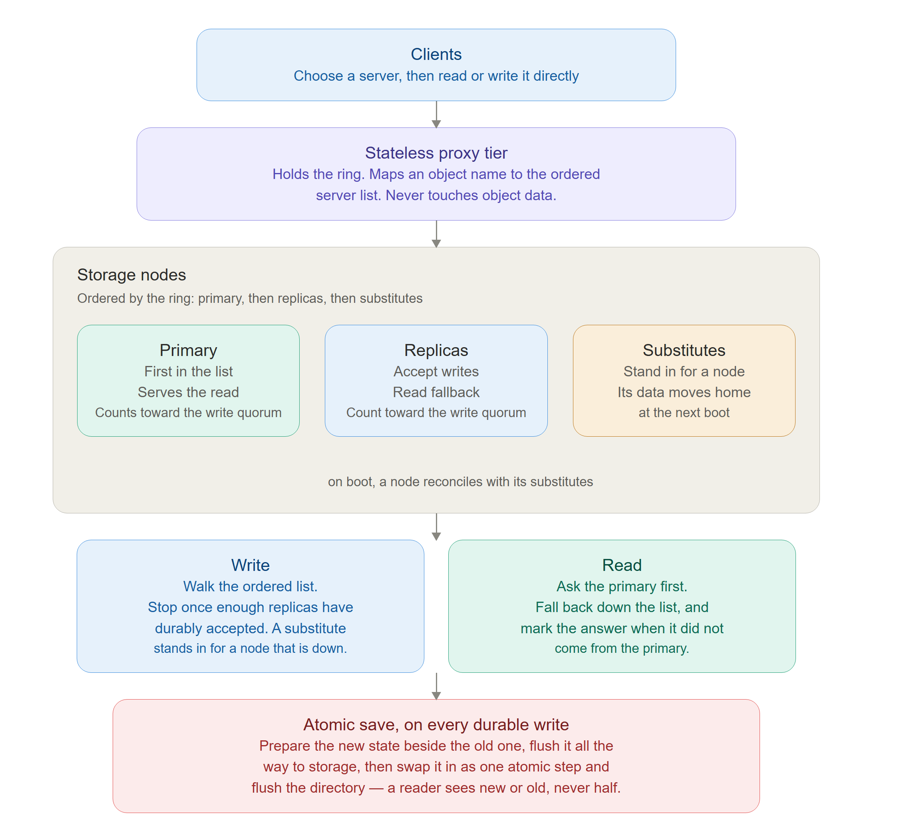
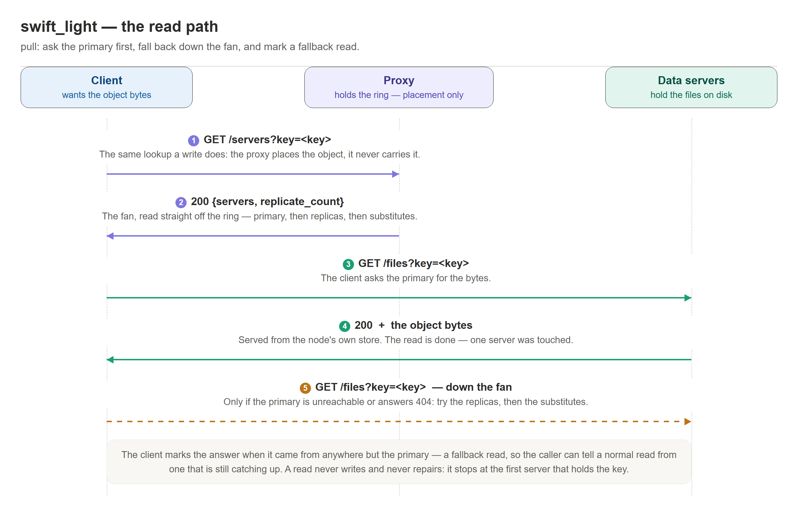
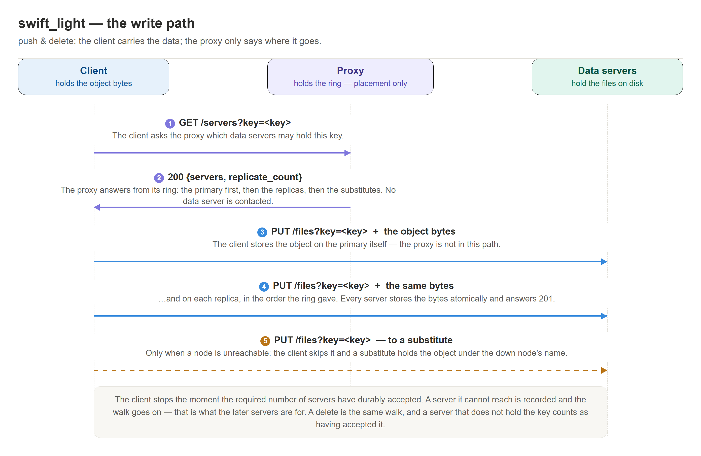

# Design Document

*Due in the `demo-2` branch, updated for `demo-3` and `final-demo`.
**The TA will run this document.** If they cannot follow it, you lose the points.*

## 1. Architecture

`swift_light` is a three-tier object store laid out the way upstream Swift is: a client, a proxy
tier, and a set of storage nodes, with no metadata master anywhere in the path. Placement comes
from a consistent-hashing ring that every proxy holds a copy of, so any proxy can answer "where
does this object live?". The ring is stored on disk, which makes it survives a crash.
For each object the ring yields an ordered list of servers that may
hold it: the primary first, then the remaining replicas, then a set of substitutes further down
the list.  
A client asks the proxy for that list, then talks to the storage nodes directly.



### Read in Swift Light

A read begins with the proxy, which maps the object's key to its fan from the ring. The client
takes that list and reads from the primary (`fan[0]`) first; only if the primary is unreachable or
does not hold the key does it move on, trying the secondaries and then the handoff servers in
turn. Whenever a server other than the primary supplies the object, the client notes the fallback 
so the caller can distinguish a normal read from one that is still catching up.



### Write in Swift Light

A write also starts with the same proxy lookup, but then fans out: the client walks the fan in
order and stops as soon as `replicate_count` servers have durably accepted the change -- the
quorum. Because the walk keeps going past a failed server, a write still succeeds while a replica
is down: the handoff servers further down the fan take its place. If the quorum is never reached,
the command fails.



## 2. Design decisions

The choices that mattered, the alternatives, and why you chose as you did.
Include the things that did not work.

## 3. Setup

### Hardware Assumptions

| | |
| --- | --- |
| OS | Linux |
| Python | 3.12 |
| Disk | A few GB.|
| Free ports | `8000` (proxy, for clients), `8010` (proxy, for data servers), and `9001`–`9003` (the three data servers).|

```bash
git clone https://github.com/ec528-fall26/swift.git
cd swift
git checkout Demo2_BugFix
```

### Using the team's LightSail instance

The team has a LightSail instance with Ubuntu 24.04 with setup completed.
It is possible to access the instance `SwiftLight` after accepting the email invitation to the team's
AWS project. This can be done by clicking `Connect using SSH` in the LightSail dashboard.

### Starting the cluster

`deploy.py` is the entry point of the system. For experimenting basic functions, it starts the cluster with
three data servers, and a write is considered success after 2 write success is received.

```bash
python3 src/swift_light/deploy.py up
python3 src/swift_light/deploy.py status
```

### Shutting down

```bash
python3 src/swift_light/deploy.py down
```

### Exit codes

| Code | Meaning |
| --- | --- |
| `0` | The command succeeded. |
| `1` | The command ran but the cluster misbehaved: a process died, the ring does not describe the cluster asked for, nothing answered in time, or a write reached fewer than `replicate_count` replicas. |
| `77` | The command could not be attempted: bad arguments, a port already in use, or a ring that cannot be built. |

## 4. Running the experiments

All experiments need the cluster running. Once the setup process is completed, experiments can be run in a separate terminal.

They also expect the team's files `SwiftLightFiles/Hello.txt`.

### Experiment 1: a write is durable on a quorum of data servers

| | |
| --- | --- |
| Supports | The write path in section 1: the client asks the proxy for the key's fan, then walks it until `replicate_count` servers have durably accepted. |
| Command | `python3 experiments/swift_light/exp1_write_file.py` |
| Expected runtime | Seconds. |
| Expected output |`wrote '<key>' to 2/2 replicas` |

#### How to run the experiment

```bash
cd <cloned swift repo directory>

python experiments/swift_light/exp1_write_file.py
echo "exit=$?"
```

#### In the team's LightSail instance

```bash
cd /home/ubuntu/swift

python3 experiments/swift_light/exp1_write_file.py
echo "exit=$?"
```

This uploads `SwiftLightFiles/Hello.txt` into the cluster under the path
`MyTxtFiles/Hello.txt`, which the cluster files as the key
`<login>-MyTxtFiles-Hello.txt`.

### Experiment 2: a read returns the same bytes

| | |
| --- | --- |
| Supports | The read path in section 1: the client reads from the primary (`fan[0]`) and says so when another server answers instead. |
| Command | `python3 experiments/swift_light/exp2_read_file.py` |
| Expected runtime | Seconds. |
| Expected output | `fetched '<key>' (<n> bytes) from <server> (primary)` |
| Requires | Experiment 1 to have run first. |

#### How to run the experiment

```bash
cd <cloned swift repo directory>

python experiments/swift_light/exp2_read_file.py
echo "exit=$?"
```

Optional: to take a look at the downloaded file

```bash
cd <cloned swift repo directory>/SwiftLightFiles

<your favorite text editor> Hello_downloaded.txt
```

#### In the team's LightSail instance

```bash
cd /home/ubuntu/swift

python3 experiments/swift_light/exp2_read_file.py
echo "exit=$?"
```

Optional: to take a look at the downloaded file

```bash
cd /home/ubuntu/swift/SwiftLightFiles

emacs Hello_downloaded.txt
```

This downloads `MyTxtFiles/Hello.txt` into `SwiftLightFiles/Hello_downloaded.txt`
and checks it byte-for-byte against the original `SwiftLightFiles/Hello.txt`, so
a short read or a stale replica fails instead of passing quietly.

## 5. Claims and limitations

### Claims

### What we aim to solve in Demo3

- We currently don't have experiments testing the system during network partition and machine failures because we haven't
implemented logic simulating these situations such as manually shutting a data server down.
- Due to the lack of metric tracking logic, it's currently impossible to see what's inside the hashing ring and data server
file systems. These are crucial for a system built for testing purposes.

### Limitations

- Swift uses SQLite for its metadata: each account and container server keeps the object
listings in a local SQLite database, and the replicator reads those databases to find and
repair stale copies. We left this out because it is irrelevant to what we are testing: the
experiments cover placement, quorum writes, and read fallback, not listing or container
operations and not background replication. 